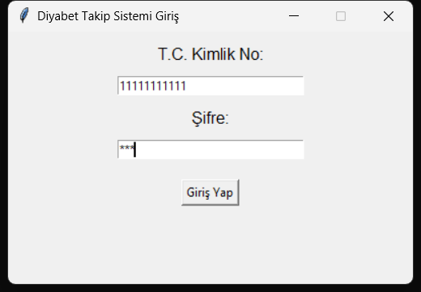

# Diyabet Takip Sistemi

Doktor ve hastanın giriş yapabildiği, kan şekeri ölçümlerini, diyet ve egzersiz uyumunu takip eden masaüstü uygulaması. Python Tkinter ile yapıldı, veriler MySQL'de duruyor.



## Neler var

- T.C. Kimlik No ve şifre ile giriş, doktor ve hasta için ayrı ekranlar
- Kan şekeri ölçümlerinin kaydı ve grafiği (matplotlib)
- Diyet ve egzersiz planları, belirti kaydı
- Kan şekeri eşik değerlerine göre otomatik uyarı
- İnsülin doz önerisi
- Hasta uyum skoru (diyet, egzersiz, ölçüm) ve son 30 günün grafiği
- Doktordan hastaya bildirim

## Kullanılanlar

Python, Tkinter, MySQL, matplotlib, tkcalendar

## Çalıştırma

```
pip install -r requirements.txt
mysql -u root -p < diyabet_takip_sistemi_schema.sql
```

Veritabanı bilgileri ortam değişkenlerinden okunuyor (Windows):

```
set DB_HOST=localhost
set DB_USER=root
set DB_PASSWORD=mysql_sifreniz
set DB_NAME=diyabet_takip_sistemi
python diyabet_takip_sistemi.py
```

## Demo hesaplar

Şema dosyası örnek (sahte) verilerle iki kullanıcı ekliyor:

- Doktor: T.C. No `11111111111`, şifre `doktor123`
- Hasta: T.C. No `22222222222`, şifre `hasta123`
