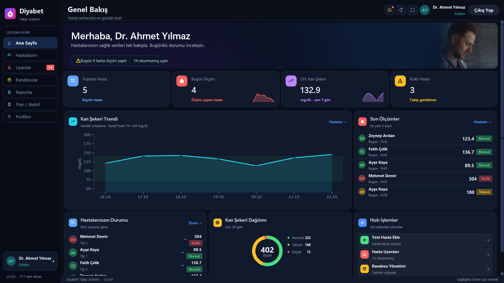
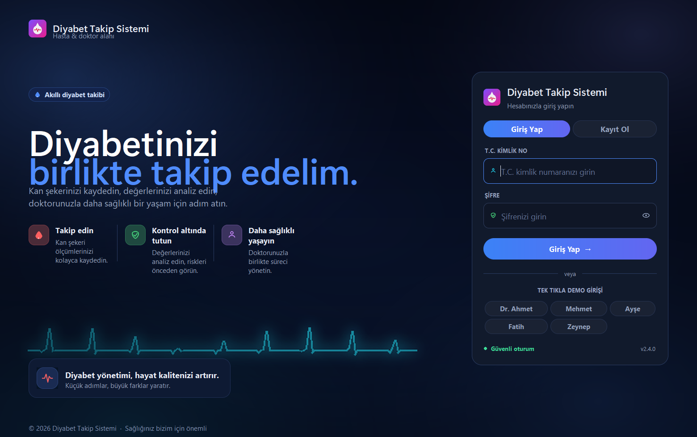
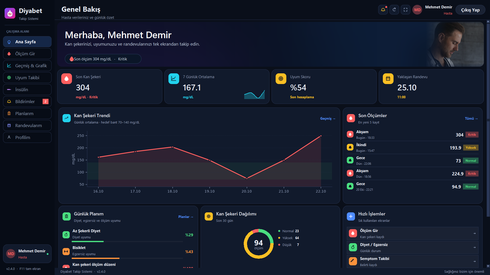
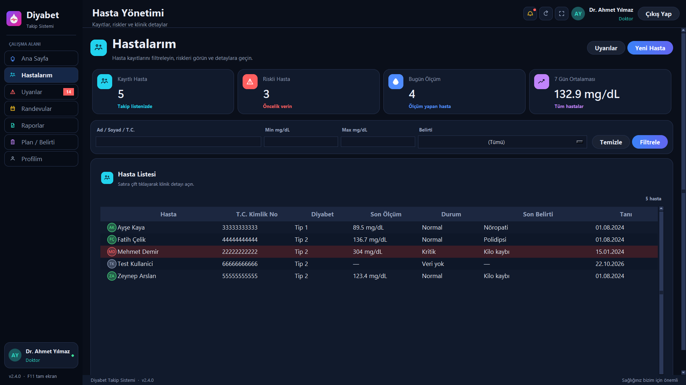
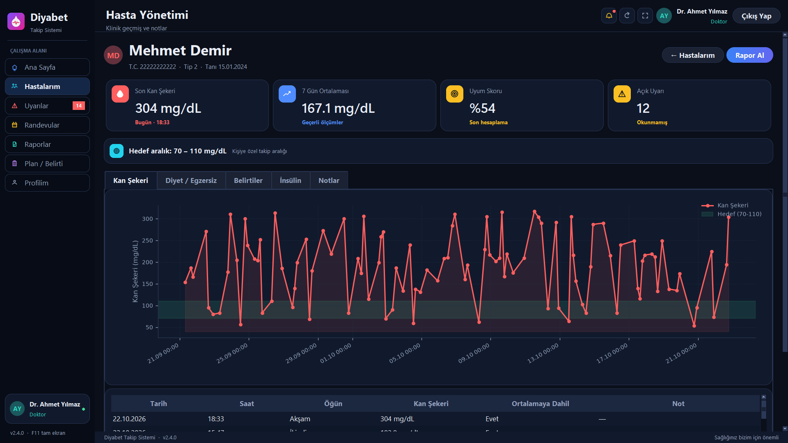
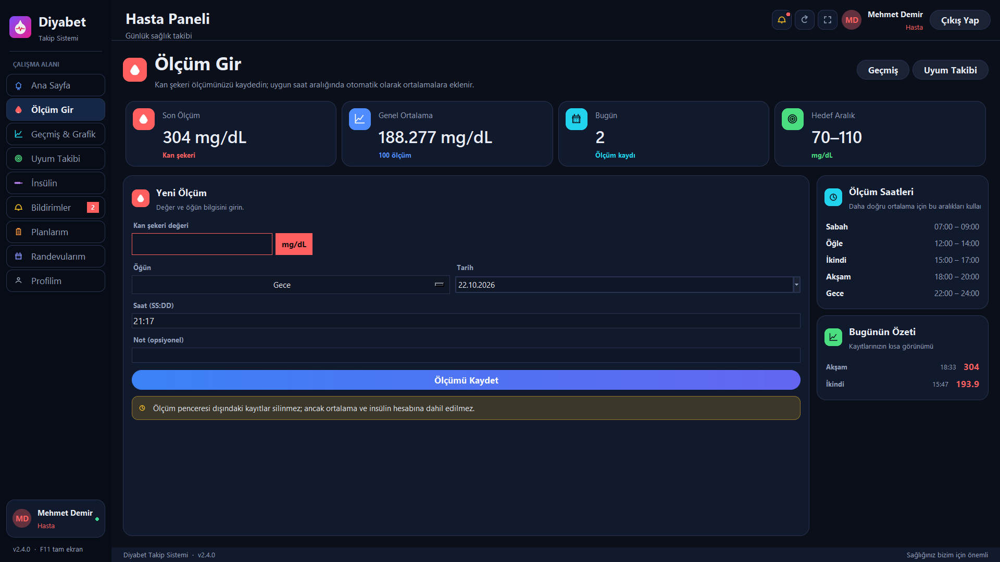
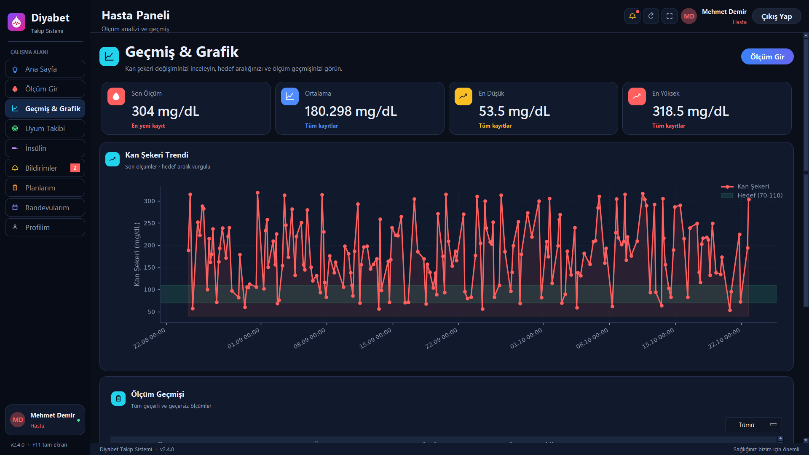
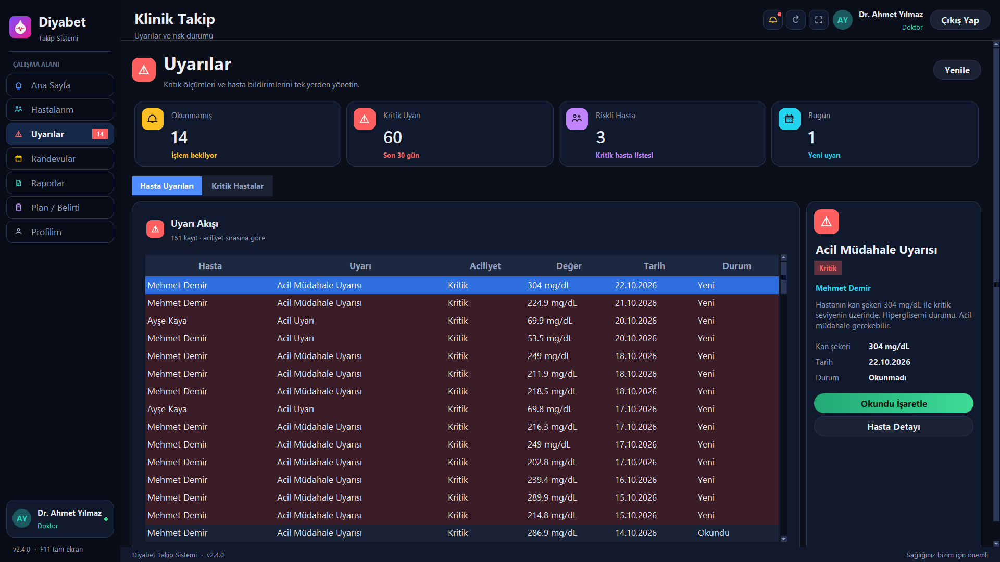
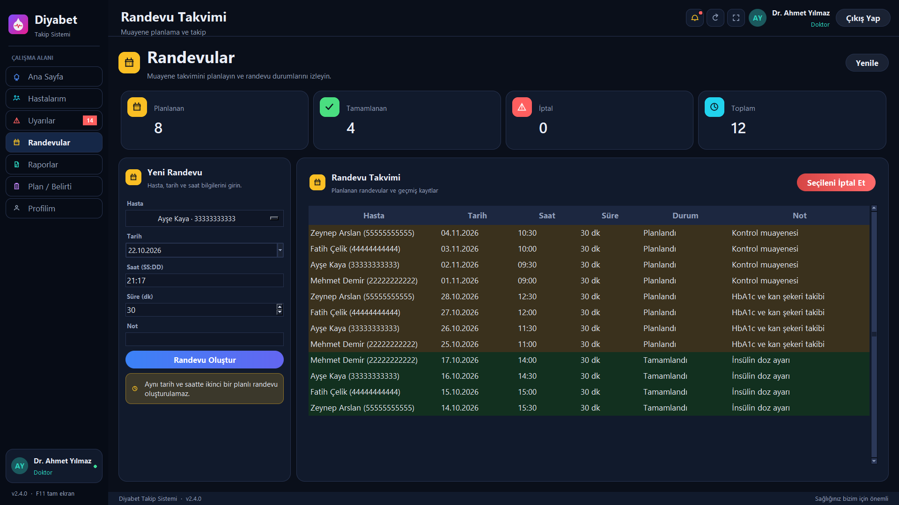

# Diyabet Takip Sistemi

[](https://github.com/CaptainGM/diyabet-takip-sistemi/actions/workflows/ci.yml)
[](LICENSE)

Doktor ve hasta rolleriyle çalışan, kan şekeri ölçümü, uyarı, insülin önerisi,
uyum takibi ve randevuları tek panoda toplayan bir masaüstü uygulaması
(**Python · Tkinter · MongoDB**).

<p align="center"></p>

<table>
<tr>
<td width="25%"></td>
<td width="25%"></td>
<td width="25%"></td>
<td width="25%"></td>
</tr>
<tr>
<td align="center"><sub>Giriş</sub></td>
<td align="center"><sub>Hasta ana sayfası</sub></td>
<td align="center"><sub>Hastalarım</sub></td>
<td align="center"><sub>Hasta detayı</sub></td>
</tr>
<tr>
<td width="25%"></td>
<td width="25%"></td>
<td width="25%"></td>
<td width="25%"></td>
</tr>
<tr>
<td align="center"><sub>Ölçüm girişi</sub></td>
<td align="center"><sub>Geçmiş & grafik</sub></td>
<td align="center"><sub>Uyarılar</sub></td>
<td align="center"><sub>Randevular</sub></td>
</tr>
</table>

<p align="right"><sub>Tüm ekranlar → <a href="docs/screenshots/">docs/screenshots/</a></sub></p>

## Özellikler

- Kan şekeri ölçümü; öğün/saat aralığına göre geçerli/saat dışı ayrımı ve hedef bantlı grafik
- Eşik tabanlı otomatik uyarı zinciri (hipo/hiperglisemi → doktora kritik uyarı)
- Diyet/egzersiz planları, uyum skoru, insülin doz önerisi
- Doktor için hasta filtreleme, plan atama, rapor ve randevu yönetimi
- Bildirim merkezi, profil ve güçlü şifre politikası

## Kurulum

```bash
pip install -r requirements.txt
docker compose up -d                                      # ya da kendi mongod'unuz
python scripts/generate_demo_data.py --reset --days 90    # demo veri
python main.py
```

Windows: `baslat.bat` çift tıkla başlatır (paket + MongoDB kontrolü dahil).
Doğrulama: `python scripts/smoke_test.py` (33 uçtan uca denetim).

## Demo hesaplar

| Rol | T.C. No | Şifre |
| --- | --- | --- |
| Doktor | `11111111111` | `doktor123` |
| Hasta | `22222222222` | `hasta123` |

Giriş ekranındaki demo çipleriyle şifre yazmadan da denenebilir. Demo şifreleri
bilinçli olarak basittir; yeni kayıt ve şifre değişiminde güçlü şifre politikası
(en az 8 karakter, büyük/küçük harf, rakam, özel karakter) zorunludur.

## Daha fazlası

- [`docs/proje-yapisi.md`](docs/proje-yapisi.md) — dosya haritası ve mimari
- [`docs/data-model.md`](docs/data-model.md) — veri modeli
- [`CHANGELOG.md`](CHANGELOG.md) — sürüm geçmişi
- [`CONTRIBUTING.md`](CONTRIBUTING.md) — katkı kılavuzu
- [`LICENSE`](LICENSE) — MIT

---

**Görsel kaynak notu:** Ana sayfa karşılama fotoğrafı
[Pexels #5452293](https://www.pexels.com/photo/5452293/) ücretsiz lisansıyla
kullanılmıştır.
